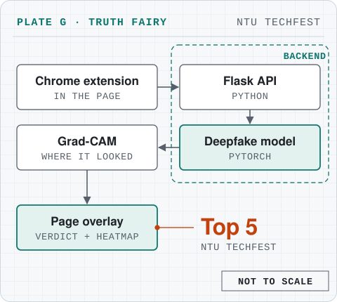
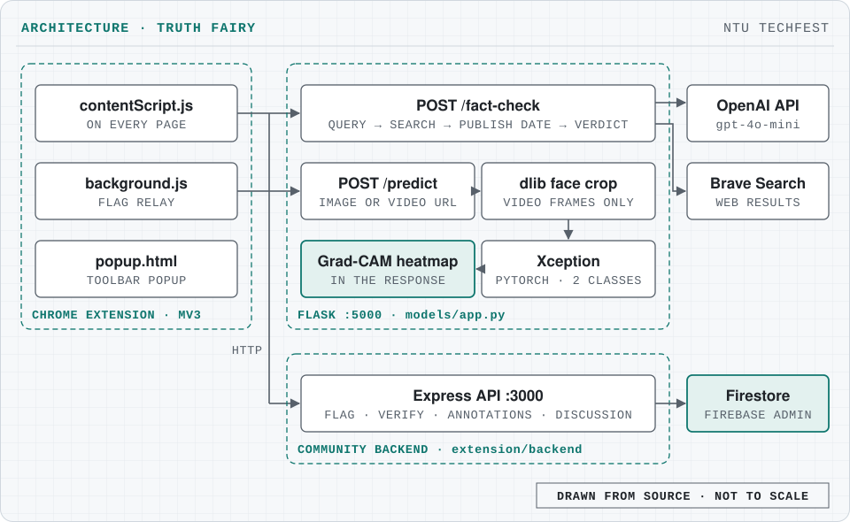

# Meet **Truth Fairy** 🧚 – Your Chrome Extension Ally Against Misinformation

Chrome extension that fact-checks highlighted text and flags manipulated images with a deepfake detector explained by Grad-CAM; Top 5 at NTU TechFest.

[](https://developer.mozilla.org/docs/Web/JavaScript)
[](https://developer.chrome.com/docs/extensions)
[](https://pytorch.org/)
[](https://flask.palletsprojects.com/)
[](#)

<picture>
  <source media="(prefers-color-scheme: dark)" srcset="docs/plate-dark.svg">
  
</picture>

## What it does

Truth Fairy empowers you to spot misinformation as you browse. Whether it’s a suspicious text snippet or a manipulated image, our extension brings the truth to light—fast and fun!

### ✨ Key features

- **Instant Verification ✅/❌:** Simply highlight content. If it’s false, it turns red; if true, it briefly glows green with extra info.
- **Image Analysis 👁️:** Our enhanced deep learning model, powered by explainable AI (using Grad-CAM), detects deepfakes and highlights manipulated regions.
- **Community Engagement 💬:** Join real-time discussions and view fact-checked comments via our built-in panel.
- **Misinformation Scoring 📊:** Each statement is scored to indicate its reliability.

## Architecture

<picture>
  <source media="(prefers-color-scheme: dark)" srcset="docs/architecture-dark.svg">
  
</picture>

- **Extension** ([extension/frontend](extension/frontend)). A Manifest V3 Chrome extension: the content script runs on every page (highlighting, image checks, annotations, discussion panel), the background service worker relays flag requests to the backend, and the popup sits on the toolbar.
- **Fact-checking** (`POST /fact-check` in [models/app.py](models/app.py)). GPT-4o-mini turns the highlighted claim into a search query, the Brave Search API returns sources ([rag_brave_pipeline.py](models/factcheck_model/rag_brave_pipeline.py)), the page's publish date is looked up ([retrieve_time.py](models/factcheck_model/retrieve_time.py)), and GPT-4o-mini returns the verdict.
- **Deepfake detection** (`POST /predict`). The server downloads the image or video (for video, dlib crops the face in each frame), classifies it with a fine-tuned Xception network in PyTorch ([models/deepfake_detection](models/deepfake_detection)) and returns a Grad-CAM heatmap of the regions that drove the decision.
- **Community backend** ([extension/backend/index.js](extension/backend/index.js)). An Express server on port 3000 stores flagged texts and images, verifications, annotations and discussion threads in Firestore through the Firebase Admin SDK.
- Everything runs locally: the extension calls `http://127.0.0.1:5000` and `http://localhost:3000`.

## Tech stack

| Part | Tools |
|---|---|
| Extension | JavaScript, Chrome Extensions Manifest V3 |
| Model server | Python, Flask, flask-cors, OpenCV, dlib |
| Deepfake model | PyTorch, torchvision, Xception, Grad-CAM |
| Fact-checking | OpenAI API (GPT-4o-mini), Brave Search API |
| Community backend | Node.js, Express, Firebase Admin SDK, Cloud Firestore |

## Getting started

### 🚀 Setup environment

Set up your development environment with the following commands:

```bash
# Create and activate the virtual environment
python -m venv env
source env/bin/activate

# Install dependencies
pip install -r requirements.txt
pip install dlib   # imported by models/app.py, not listed in requirements.txt

# Install backend dependencies
cd extension/backend
npm install
cd ../..
```

### 🏃‍♂️ Running the app

Follow these steps to launch the application:

1. **Create a `.env` file** with the OpenAI and Brave Search keys (ask a maintainer for them). Variable names:

```text
OPENAI_KEY
BRAVE_API_KEY
```

2. **Start the backend server** (port 3000; `PORT` overrides it):

```bash
cd extension/backend
node index.js

# It'll prompt you for firebase_credentials.json, ask a maintainer for it, then rerun the node command.
```

3. **Start the model server** (fact-checking and deepfake detection, port 5000):

```bash
cd ../..
cd models/deepfake_detection
# Place the pretrained weights in the 'pretrained_model' folder (see link below)
pip install .
cd ..
python app.py
```

Now both servers are up and running!

### 🧩 Using the extension

1. Open **Google Chrome** and go to **Manage Extensions**.
2. Click **Load Unpacked** and select the `extension/frontend` folder.
3. Enjoy safer browsing and join the conversation!

### 📥 Pretrained weights

Download the pretrained weights here:
[Pretrained Weights on Google Drive](https://drive.google.com/drive/folders/16bI7-2H2FaCOE0FTw4ZaRdpsJIzT4EjZ?usp=sharing)

The model server loads `models/deepfake_detection/pretrained_model/14_finetuned_xception.pkl`.

## Project structure

```text
.
├── extension/
│   ├── frontend/              # Chrome extension: manifest, content script, background, popup
│   ├── backend/               # Express + Firestore community API (index.js)
│   └── guide/                 # user guide page
├── models/
│   ├── app.py                 # Flask server: /fact-check and /predict
│   ├── factcheck_model/       # Brave search and publish-date helpers
│   └── deepfake_detection/    # Xception network, transforms, Grad-CAM
└── requirements.txt
```

---

Feel free to contribute and help us build a more truthful online community!
